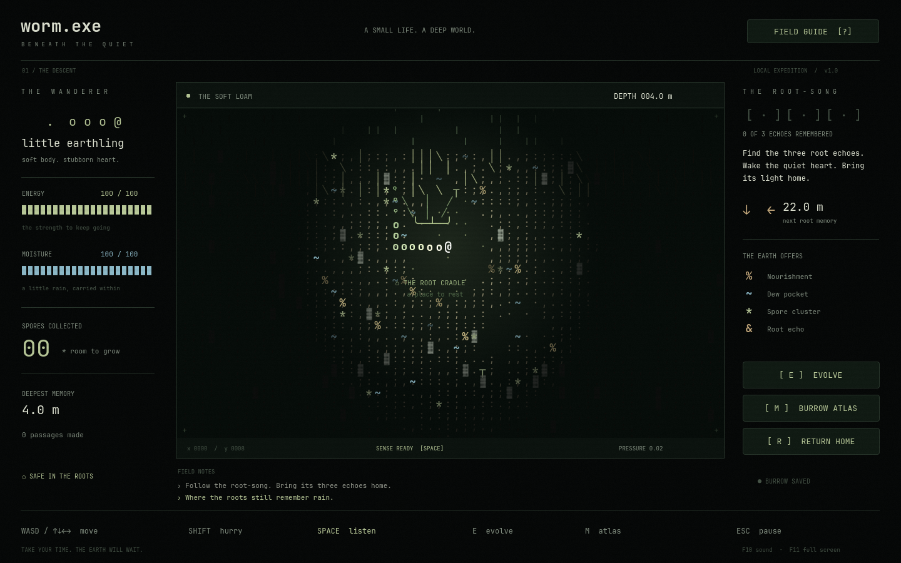

# worm.exe

**Beneath the Quiet** — a cozy, atmospheric ASCII adventure made in Godot 4.4+.

A small life. A deep world. Carry a little rain through the earth, follow the root-song, and bring a forgotten light home.



## Play

Open **`project.godot`** in Godot and press **F5**. Press **Enter** or click **Enter the earth** on the title screen.

On Linux/macOS with Godot on your PATH:

```bash
git clone --branch feat/beneath-the-quiet https://github.com/issamarida/worm.exe.git
cd worm.exe
./tools/run.sh
```

If your executable is named `godot4`, use `GODOT_BIN=godot4 ./tools/run.sh`. The helper imports assets before launching a fresh checkout. No plugins, packages, API keys or network access are needed to play.

| Input | Action |
| --- | --- |
| WASD / arrows | Move and dig; your body follows |
| Shift | Hurry, using more energy and moisture |
| Space | Listen: expand sensing for five seconds |
| E | Evolve through three skill branches |
| M / mouse wheel | Burrow atlas / zoom |
| R | Return safely to the root cradle |
| Esc | Pause and settings |
| F1 | Field guide |
| F10 / F11 | Sound / fullscreen |

Find **three `&` root echoes**, then **`Ω` at 103m**, and bring its light home. `%` provides food, `~` provides dew, and `*` provides spores. Rest in the root cradle or press R to return. If you run dry or tired, the roots rescue you; evolutions, echoes and passages remain, while 30% of unspent spores return to the earth. Menus pause time. The completed world remains open for exploration.

## Included

- A complete journey, ending, and continued procedural exploration.
- Deterministic, streamed soil with five strata and persistent passages.
- A smoothly interpolated twelve-segment worm with cardinal movement.
- Energy, moisture, friction, density, depth pressure, resting and rescue.
- Twelve resource-defined skills across **The Prism-Tunneler**, **The Earth-Shaper**, and **The Resilient Core**.
- An ASCII field with soft canvas light, bioluminescent discoveries and optional terminal film.
- Interactive skill cards, explored-world atlas, guide, title and pause menus.
- Original ambient sound; sound, film and reduced-motion settings.
- Automatic checksummed saves with last-good recovery.
- Linux, Windows and Web export presets, CI and 116 behavioral checks.

## Validate and develop

```bash
python3 tools/validate.py
```

The command imports assets, parses every runtime script, runs both suites, and smoke-tests startup with isolated test saves. Python 3 and Godot 4.4+ are the only requirements.

- [Complete blueprint, directory layout, equations and interfaces](docs/BLUEPRINT.md)
- [Progressive AI implementation and integration workflow](docs/AI_WORKFLOW.md)
- [Testing, visual QA, save location and exports](docs/TESTING.md)
- [Attribution](THIRD_PARTY.md)

Development uses `feat/beneath-the-quiet`, focused commits, and a pull request into `main`. Matching Godot export templates are needed for native or Web binaries; the source project is ready to run in the editor.

Original code/assets: [MIT](LICENSE). JetBrains Mono fonts: [SIL OFL 1.1](assets/fonts/OFL.txt).
