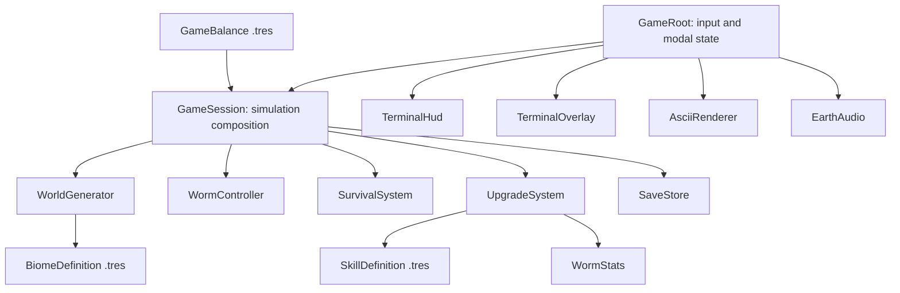

# worm.exe — Beneath the Quiet

An original, playable subterranean adventure in Godot 4.4+, with an ASCII world, a small persistent expedition, and an ending. The visual direction draws on the quiet, high-contrast language of terminal games; all code, sound, narrative, layouts and procedural content are original.

## Experience and scope

The player is a twelve-segment worm, carrying energy, moisture and a faint personal light through the earth. There are no enemies, contact damage or self-collision penalties. The tension comes from weight, dryness, unfamiliar soil and deciding when to return to the roots. A free, two-second recall keeps exploration gentle without making the survival meters decorative. Exhaustion brings a soft rescue and returns 30% of unspent spores to the soil; bought evolutions, collected echoes and passages persist.

The complete objective is to find three root echoes, awaken the quiet heart at 103m, then bring it to the root cradle. The ending pauses the game and offers continued exploration. The authored landmarks coexist with procedural terrain that extends horizontally and downward, beyond the final biome. The surface is the only hard boundary. Dense stone can always be dug, at greater cost.

1. Move through a cell; pay for its density, friction and pressure.
2. Collect food, dew and spore clusters; use a sensing pulse to plan the route.
3. Choose an evolution from three branches, with prerequisites and multiple ranks.
4. Find a root echo; each grants nine spores and restores both survival meters.
5. Return to rest when needed, then descend farther with improved capabilities.
6. Bring the quiet heart home, or keep exploring the persistent world.

## Directory layout

```text
project.godot                   # Engine, viewport and Compatibility renderer settings
export_presets.cfg             # Linux, Windows and single-threaded Web presets
assets/
  icon.svg                     # Original application icon
  fonts/                       # Bundled JetBrains Mono Regular/Bold and OFL license
  audio/                       # Six original, reproducible PCM sound assets
data/
  balance.tres                 # Simulation constants, seed and objective coordinates
  biomes/                      # Five BiomeDefinition resources
  skills/                      # Twelve independent SkillDefinition resources
scenes/
  main.tscn                    # Composition, field, HUD, audio and modal overlay
  game/session.tscn            # Simulation and its explicit dependencies
  player/worm.tscn             # Reusable logical worm controller
scripts/
  core/                        # Root routing, session, input and save store
  data/                        # Resource schemas and derived worm attributes
  world/                       # SoilCell values and deterministic chunk generator
  player/                      # Segmented movement and survival equations
  progression/                 # Catalog loading, purchase validation and stat rebuilds
  rendering/                   # Visible ASCII grid, camera, glow and pickup effects
  ui/                          # Terminal styling, buttons, HUD, skills, atlas and menus
  audio/                       # Ambient loop and bounded one-shot player pool
shaders/terminal_film.gdshader  # Optional grain, scanlines and vignette
tests/
  run_tests.gd                 # Simulation, persistence and full objective route
  test_ui.gd                   # Real controls, keyboard, modals and settings
  capture_game.gd              # Six rendered screenshots for visual QA
tools/
  run.sh                       # Import and start a fresh source checkout
  validate.py                  # Import, parse every runtime script, test and smoke-test
  generate_audio.py            # Deterministic standard-library audio synthesis
docs/
  BLUEPRINT.md                 # This design and architecture reference
  AI_WORKFLOW.md               # Progressive implementation and integration contracts
  TESTING.md                   # Automated and manual release checks
.github/workflows/validate.yml # Godot 4.4.1 / 4.5.1 validation on pushes and PRs
```

## Ownership and dependencies



There are no global gameplay autoloads and no scene-path lookups from individual systems to the interface. `GameSession` connects movement, depletion and purchase signals. `GameRoot` binds the views and routes input. Rendering and audio read state and react to typed signals; neither can decide rewards or survival costs. The renderer can be replaced without rewriting the simulation. Resource definitions are shared immutable catalog data by convention; purchased ranks are separate per-session dictionaries, and a fresh `WormStats` instance is rebuilt after each purchase or load.

### Important interfaces

| Owner | Contract | Consumers |
| --- | --- | --- |
| WorldGenerator | `configure(balance, seed)`, `get_cell(Vector2i)`, `dig`, `collect`, `reveal`, `biome_at` | Session, worm and rendering |
| WormController | `tick(delta, direction, sprint, world, stats)`, `reset`, `restore`, `head_position`, `interpolated_body` | Session and renderer |
| WormController | `step_started(position, soil, sprinting)` and `stepped(position, soil, sprinting)` | Survival costs and completed-step rewards |
| SurvivalSystem | `tick`, `consume_step`, `restore_pickup`, `set_stats`, `depleted(reason)` | Session |
| UpgradeSystem | `purchase(id)`, `locked_reason`, `rank_of`, `rebuild_stats`, `validate_catalog` | Session and skill cards |
| GameSession | `sense`, `recall`, `snapshot`, `restore`, `save_game`, `load_game`, typed state signals | Root, HUD, audio and overlays |
| SaveStore | `write_save(Dictionary, path)`, `read_save(path)` | Session and tests |

## World generation

The world uses integer grid coordinates. Each 24×24 chunk contains lightweight `SoilCell` objects rather than scene nodes. A 31-bit coordinate hash determines glyph variation, stone and resource placement. Two independently seeded `FastNoiseLite` fields create caverns and density variation. Generation does not consume a shared RNG, so visiting cells in a different order cannot change the terrain.

At most 64 chunks are resident. A FIFO cache evicts generated values; three coordinate-indexed stores preserve dug/consumed cells, explored cells and softened soil. Returning to an evicted chunk regenerates its original cells and applies those edits. The cache limits terrain memory; persistent history grows with the places visited. This deliberately simple format is appropriate for a single-player expedition and is documented as a future seam for region-file persistence.

| Stratum | Starts at | Density | Dryness | Direction |
| --- | --- | --- | --- | --- |
| The Soft Loam | 0m | 0.75 | 0.80 | Warm loam, old roots, muted green |
| The Hushed Clay | 19m | 1.35 | 1.15 | Brown clay, gold root memories |
| The Mycelial Choir | 40m | 1.05 | 0.75 | Cool charcoal, cyan fungal light |
| The Memory Shale | 67m | 1.80 | 1.30 | Dense monochrome shale, violet traces |
| The Velvet Deep | 95m | 2.15 | 1.40 | Near-black mineral soil, faint rose |

One cell corresponds to 0.5m on the instruments. Root echoes are at `(-14,44)`, `(20,94)` and `(-18,150)`; the quiet heart is at `(0,206)`. The atlas marks these landmarks. The opening places guaranteed food, dew and spores near the root cradle so a bad procedural roll cannot hide the mechanics.

## Movement and survival

`WormController` uses a historical-cell shift register. Before a step, it copies the body cells. It then moves the head one cardinal cell and gives every following segment its predecessor's last cell. Self-crossings and reversing are legal. `head_position()` and `interpolated_body()` interpolate those two snapshots with a smooth cubic blend; optional subpixel oscillation gives the body a gentle life without altering the grid.

The step duration is `base × (0.75 + 0.42 × sqrt(max(0.2, density / dig_efficiency))) / tunnel_speed`. Hurrying multiplies it by 0.65. Costs are charged when the step starts, so saving during interpolation cannot bypass survival costs. Pickups and objective progress resolve when the step completes.

```text
pressure = max(0, depth_cells × 0.003) × (1 − min(0.85, pressure_resistance))
friction = soil_friction × (1.5 when hurrying, otherwise 1.0)

step_energy = 0.30 × density × friction × (1 + pressure) / dig_efficiency
step_moisture = 0.065 × dryness × friction × (1 + pressure) / moisture_efficiency

idle_energy_per_second = 0.055 × (1 + pressure)
idle_moisture_per_second = 0.095 × dryness × (1 + pressure) / moisture_efficiency
```

The root cradle restores six energy and eight moisture per second, multiplied by `rest_rate`. Food restores 18 energy. Dew restores `22 × moisture_gain` moisture. Root echoes and the heart restore 35 of each meter. A spore cluster yields two currency units. Pulse sensing costs `3 / pulse_efficiency` energy, lasts five seconds, and has an eight-second cooldown. Recall channels for two seconds, suspending movement and further survival decay, then returns the worm and its inventory home.

## Resource-driven evolution tree

Every row below is an external `.tres` file. A child requires at least one rank of its parent. The current-rank price is `base_cost + cost_per_rank × rank`. All effects are additive to derived base attributes; efficiency attributes are denominators or movement divisors, not percentage discounts.

| Branch / skill | Ranks | First cost / increase | Per-rank effect | Requires |
| --- | --- | --- | --- | --- |
| Prism / Phosphor glands | 3 | 3 / +2 | +2 sight cells | — |
| Prism / Echo tasting | 2 | 5 / +3 | +4 sensing cells | Phosphor glands |
| Prism / Hidden frequencies | 1 | 9 / +0 | Passive resource sensing to scan radius | Echo tasting |
| Prism / A little aurora | 1 | 13 / +0 | +4 sight; +1 pulse efficiency | Hidden frequencies |
| Earth / A softer jaw | 3 | 3 / +2 | +0.20 digging efficiency | — |
| Earth / Clay song | 2 | 5 / +3 | Soften cardinal neighboring soil by 18% | A softer jaw |
| Earth / Capillary channels | 2 | 8 / +3 | +0.30 dew restoration multiplier | Clay song |
| Earth / Silken passages | 1 | 13 / +0 | +0.25 movement speed multiplier | Capillary channels |
| Core / Slow breathing | 3 | 3 / +2 | +0.25 moisture efficiency | — |
| Core / A deeper vessel | 2 | 5 / +3 | +20 maximum energy | Slow breathing |
| Core / Pressure skin | 2 | 8 / +3 | +25% pressure resistance | A deeper vessel |
| Core / The home within | 1 | 13 / +0 | +25 maximum moisture; +1 rest multiplier | Pressure skin |

Adding a skill requires a resource, an entry in `SKILL_PATHS`, and a supported effect key. New behavior also needs an attribute in `WormStats.apply_effect` and the consuming system. Catalog validation detects duplicate IDs, invalid prices/ranks, missing prerequisites and cycles. The interface derives availability and prices from the same system used by purchases.

## Visual and audio engine

The field draws an approximately 63×30 visible character lattice, at 14×18 logical pixels per cell. It uses one custom `Control` drawing pass rather than thousands of `Label` nodes. Glyph brightness follows distance from the interpolated head, with a dim memory for explored cells and much fainter unresolved terrain. Items beyond the sensory radius are hidden. A pulse temporarily expands the radius and draws a gentle expanding ring.

Soft light comes from a radial `GradientTexture2D`, a `PointLight2D` over the canvas, and restrained colored halos near significant discoveries. The five biome palettes share the same near-black ground. The worm remains the brightest object: cream at the head, moss toward the tail. A final screen-reading `canvas_item` shader adds subtle grain, scanlines and vignette. Players can disable the film or reduce motion; reduced motion snaps the camera, removes body oscillation and pulse rings, and freezes film noise.

The interface uses standard `Button` controls with custom terminal styling, a drawn HUD, interactive skill cards, and a scroll-zoom atlas. A 1440×900 logical canvas letterboxes to the window. All menus pause simulation. Losing application focus pauses an active expedition.

The original ambient loop and five small effects are shipped as WAV files and regenerated by `tools/generate_audio.py`, using only Python's standard library. A six-player pool bounds one-shot audio allocations. F10 toggles sound; settings persist in a separate config file.

## Persistence, delivery and limits

`SaveStore` saves versioned, SHA-256-checked JSON to `user://burrow-v1.json`. It flushes a temporary file, moves the previous save to `.bak`, and replaces the primary. Load falls back to the backup if the primary is malformed, has the wrong version, or fails its checksum. External data is type-checked at the boundary, body adjacency is validated, ranks and effect ranges are clamped, and unknown catalog IDs are ignored. Never load external save content as GDScript or arbitrary resources.

Saves include seed, body, survival values, currency, purchased ranks, world edits, explored cells, softened soil, objective state, expedition statistics and field notes. Sensing and recall timers intentionally reset when loading. Saves occur every 20 active seconds, after discoveries/evolution/return, and on window close or save-and-title/quit. Source-checkout validation uses temporary XDG data directories so it does not touch a player's save.

The save reader limits envelopes to 64 MiB and each world-history array to one million entries; saved coordinates are limited to ±1,000,000. Resident terrain is bounded, but save size and explored history still grow during very long expeditions. Cross-platform seeded noise reproducibility relies on Godot's `FastNoiseLite` implementation; retain the engine version for reproducible campaigns. Huge-world streaming to region files, gamepad/touch controls, localization, and adaptive text sizing are extension points, not shipped features.

The current source project is playable and validated. Native and Web export presets are supplied; exporting binaries requires matching Godot export templates. A platform release still needs a platform-specific visual/audio and input pass. The tests exercise meaningful behavior, including a real route from relics to ending and real UI keyboard events.

## Engine references

The implementation follows Godot's [custom resources](https://docs.godotengine.org/en/stable/tutorials/scripting/resources.html), [static typing](https://docs.godotengine.org/en/stable/tutorials/scripting/gdscript/static_typing.html), and [screen-reading shader](https://docs.godotengine.org/en/stable/tutorials/shaders/screen-reading_shaders.html) guidance. Font licensing is included beside the bundled fonts.
